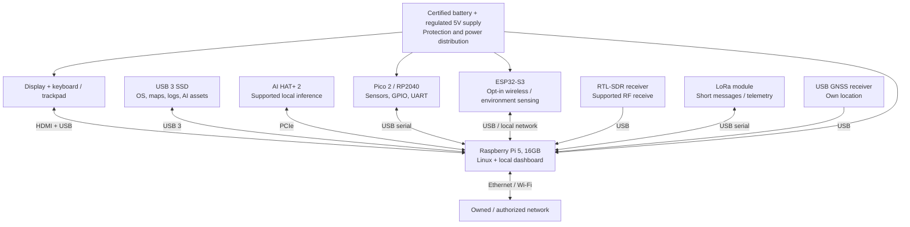
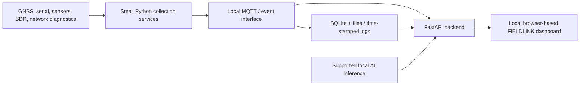

Project Owner
Name: Mohammad Abdul Rafay Chaudry
Virginia Tech Email: rafaych@vt.edu
Project Overview
FIELDLINK is a self-contained, portable engineering computer — often called a cyberdeck — built around a Raspberry Pi 5 (16GB) and an optional Raspberry Pi AI HAT+ 2. The project aims to combine the tools normally scattered across a laptop, an electronics bench, a radio receiver, and a field data logger into one modular device. The envisioned form factor is a compact protective case containing a screen, keyboard, power supply, and interchangeable electronic modules.

The system is inspired by the compact field terminals seen in science-fiction and tactical video games, but the goal is to build real, measurable engineering functionality, not a prop or a claim of military-grade equipment. FIELDLINK is intended for legitimate personal and educational use on equipment, networks, and spaces that I own or am authorized to test.

What can it do? In its proposed full configuration, FIELDLINK will:
1. Operate independently: boot Linux and run programming tools, diagnostics, a local web dashboard, and offline documentation without an internet connection (once installed and provisioned).
2. Support cybersecurity and network engineering: inspect and troubleshoot authorized Ethernet/Wi-Fi networks, view network packets, access devices by SSH, and document findings.
3. Support hardware hacking: program microcontrollers, interact with sensors, read UART serial logs, and investigate SPI/I²C protocols with suitable adapters and protection.
4. Receive and analyze radio transmissions: use a receive-only SDR to visualize radio spectrum and decode supported public/unencrypted signals when antennas and reception conditions permit.
5. Provide off-grid telemetry: exchange low-bandwidth data and short messages between compatible LoRa devices within radio range.
6. Support offline mapping: collect the cyberdeck's own GNSS position and display downloaded maps, waypoints, and route logs.
7. Monitor an instrumented environment: collect temperature, humidity, device-status, and opt-in motion/presence sensor readings and show timestamped alerts. Experimental Wi-Fi CSI sensing is a research stretch goal, not a reliable way to identify people or track them through walls.
8. Perform optional local AI inference: use the AI HAT+ 2 to run supported vision or small language models, such as classifying consented camera inputs or summarizing technical logs. AI acceleration does not make ordinary CPU tasks faster by itself.
9. Unify information into a local “mission control” view: display sensors, devices, maps, RF observations, system health, and event history in one searchable interface. It is a small-scale, user-controlled data-integration platform, not a commercial or government surveillance system.
Scope and success criteria
The minimum viable prototype (MVP) is a stable Pi-powered Linux computer that displays a local dashboard, reads at least one real sensor, and logs one network or serial diagnostic event. The complete target adds portable power, radio reception, LoRa, GNSS, and a tested AI workflow. Additional radio, sensing, and AI capabilities will only be added after the essentials work reliably.

Out of scope: covert monitoring, identifying unknown people by Wi-Fi, intercepting private communications, unauthorized network access, military certification, and guaranteed weatherproof operation.
What I Hope to Learn
- Embedded Linux: OS installation, kernel/device drivers, services, permissions, shell scripting, remote access, and recovery.
- Computer architecture and edge AI: CPU versus AI-accelerator workloads, memory limitations, model deployment and benchmarking.
- Electronics and instrumentation: digital logic levels, GPIO, UART, SPI, I²C, power regulation, grounding, fusing, and safe probing.
- Cybersecurity and networking: network protocols, packet analysis, SSH, inventory, authorized network diagnostics, and security hardening.
- RF engineering: antenna selection, software-defined radio, signal sampling, spectrum displays, receive-only decoders, and legal operating constraints.
- Wireless systems: LoRa and GNSS fundamentals, communication range testing, and sensor-to-dashboard data exchange.
- Full-stack engineering: API design, data collection services, event processing, database storage, local web dashboards, and test automation.
- Mechanical and power design: enclosure layout, thermal design, runtime measurement, connector strain relief, modular mounting, and serviceability.
- Engineering project management: component sourcing, bills of materials, version control, incremental milestones, test evidence, risk assessment, and sponsor presentations.
Design and Implementation
Proposed system architecture

Important design constraint: the Pi 5 exposes a single PCIe connection, and the AI HAT+ 2 uses it. To avoid an expensive/complex PCIe-sharing design, the first build will use a USB 3 SSD, not a competing NVMe PCIe HAT. The Pi 5 remains the standalone computer; the accelerator and microcontrollers are optional connected modules, not separate PCs.
Data and software design

Software stack (proposed): Raspberry Pi OS 64-bit, Python, FastAPI, MQTT (Mosquitto), SQLite, a lightweight web interface, NetworkManager, Wireshark/tcpdump, gpsd, Meshtastic-compatible software, and SDR applications with verified ARM64 support. Kiwix and offline OpenStreetMap extracts provide reference material. Specific AI models and software will be chosen only after testing their compatibility with the AI HAT+ 2.
Hardware selection rationale
Decision	Reason	Tradeoff
Raspberry Pi 5 16GB instead of mini PC	Native embedded interfaces, Raspberry Pi documentation/ecosystem, compact board	Lower general-purpose CPU performance than some x86 machines
AI HAT+ 2 (Hailo-10H, dedicated memory)	Accelerates supported on-device AI inference	Extra cost, power and heat; no general-purpose CPU speedup
USB 3 external SSD	Preserves PCIe for the AI HAT; ample local storage	USB cable/enclosure and shared bus bandwidth
Pico 2 microcontroller	Reliable timing and flexible I/O for electronics experiments	Additional firmware and interface management
Optional ESP32-S3	Low-cost wireless/sensor experiments, independent firmware	Wi-Fi CSI requires supported firmware, calibration and controlled tests
RTL-SDR	Low-cost receive-only radio introduction	Not a professional spectrum analyzer; limited bandwidth/range
Two LoRa nodes	Enables genuine end-to-end communications tests	Data rate is low, distance is environment dependent
Certified battery, regulated supply	Safer than a custom lithium cell pack in an early prototype	Requires current-budget and power-path verification

Electrical and mechanical planning
- Use a verified 5.1V / 5A-capable Pi 5 supply; do not assume every USB-C bank supports the required output profile. Measure peak current and test all peripherals before selecting the final supply.
- Use correctly specified, fused/protected power distribution for display and peripherals. Avoid direct connections between incompatible supply voltages.
- Pi GPIO is 3.3V logic, not tolerant of arbitrary 5V/12V/industrial signals. Use appropriate adapters, isolation, and protection.
- Preserve airflow around the Pi, fan, AI HAT and power electronics. Test temperatures with the enclosure assembled.
- Use accessible modular mounting, detachable connectors, cable strain relief, and documented pinouts.
- Avoid relying on the protective case's original water-resistance rating after cutting holes for connectors or ventilation.
- Final schematic, connector map, power budget and CAD layout will be committed after selecting exact parts and validating dimensions.
Testing methods and acceptance targets
Test	Planned evidence	Pass criteria
Core Linux stability	Boot logs, uptime, temperature measurements	2-hour representative workload without crashes or thermal shutdown
Hardware control	Pico firmware, wiring diagram, video	Dashboard command changes an LED and records sensor reading
Network diagnostics	Packet captures from lab network	Explain and record an authorized test capture without exposing secrets
Data dashboard	Screenshot + SQLite rows	Timestamped sensor events persist and display locally offline
AI workload	Model name, latency logs, screenshot	One verified supported model runs fully locally and produces repeatable output
SDR receiving	Waterfall screenshot and signal log	Receive and document one permitted/public signal in suitable conditions
LoRa	Two-node test logs	Send/receive a timestamped message using two compatible configured radios
GNSS + offline maps	Local map screenshot, coordinate logs	Outdoor fix is displayed over previously downloaded maps
Battery + thermal	Voltage/current/runtimes, temperature chart	Stable operation; runtime recorded at a specified load, target ≥2 hours
Enclosure repairability	Photos + removal/reinstall notes	Access and replace a module without damaging nearby components

Privacy and responsible use
All network testing is limited to systems with permission; RF reception/transmission follows applicable law. Camera and presence experiments occur only in informed, consent-based settings. The project will not attempt covert person tracking or identity determination from Wi-Fi signal disturbances. Logs should minimize personal information and should not publish identifiable locations, MAC addresses, passwords, API keys, packet contents, or unredacted footage.
Bill of Materials
These are USD planning estimates as of October 2026, not verified real-time checkout quotes. Exact models and purchase links will be recorded alongside receipts when ordered. The AI HAT is included in the full feature budget but can be deferred during early work.
Item	Quantity	Estimated Cost	Link
Raspberry Pi 5, 16GB	1	$305	Raspberry Pi 5
Raspberry Pi AI HAT+ 2	1	$200	AI HAT+ 2
Official-compatible active cooling	1	$20	Active Cooler
1TB USB 3 SSD (or NVMe in USB enclosure)	1	$110	SSD search
7–10-inch HDMI display	1	$100	Display options
Small USB keyboard + pointing device	1	$40	Keyboard search
Raspberry Pi Pico 2	1	$5	Pico 2
Electronics kit: breadboard, sensors, wires, UART protection	1	$35	DigiKey
ESP32-S3 development board	2	$40	ESP32-S3 documentation
RTL-SDR receive-only dongle + antenna kit	1	$65	RTL-SDR
915MHz LoRa development nodes	2	$50	Heltec LoRa
USB GNSS/GPS receiver	1	$35	Adafruit GPS options
Powered USB 3 hub	1	$30	USB hub search
Certified portable battery + regulated power adapters	1	$150	Battery options
Protective hard case + internal mounting plate	1	$90	Protective case options
Connectors, fasteners, cables, fusing, strain relief	1 lot	$75	DigiKey
Optional camera and mmWave/PIR presence sensors	1 lot	$65	Adafruit
Hardware subtotal		$1,415	
15% contingency		$212	
Estimated Total Cost		$1,627	

Estimated Total Cost: $1,627 (including contingency; excluding applicable taxes, shipping, tools and paid labor). Optional sensors add $65 to the subtotal; without them, the estimated total including 15% contingency is approximately $1,553. Unspent allowance is not automatically authorized spending.
Proposed funding releases
The former $300 budget is not enough for the revised Pi 5 16GB plus AI plan. For sponsor accountability, funding should be released at evidence-based gates rather than all at once:
Approval gate	Target week	Additional maximum release	Cumulative funding ceiling	Required demonstration
A — computing platform	Week 0	$550	$550	Approved parts list, Linux boot and stable basic dashboard plan
B — hardware + display	After Week 3	$350	$900	Boot logs, basic dashboard, GPIO/Pico and sensor readings
C — radio + sensing	After Week 6	$350	$1,250	Integrated user interface, network and sensor event logging
D — AI, field power, refinement	After Week 9	Up to $377	$1,627	Demonstrated SDR/LoRa/GNSS path, tested AI compatibility and revised electrical plan

Gate allocations are planning caps, not exact supplier subtotals. Purchase orders must be updated for actual vendor prices, tax and shipping; if an early gate lacks the cash needed for its acceptance test, use existing lab tools or seek approval to change the order rather than claiming the test occurred. The AI HAT+ 2 may be purchased in Gate A only if approved within the ceiling, otherwise later. Any change to the total budget requires a separate approval.
Timeline and Milestones
Proposed 12-week schedule: 2026-10-19 through 2027-01-10. Dates are targets, subject to lead times, sponsor review and academic availability.
Milestone	Target Date	Status
Project planning, sourcing, sponsor approval	2026-10-23	Not Started
Initial design: architecture, power diagram, enclosure dimensions	2026-11-01	Not Started
Core prototype: Pi Linux, dashboard, Pico sensor	2026-11-08	Not Started
Integration: screen, keyboard, logging and network tools	2026-11-29	Not Started
RF, LoRa, GNSS and offline demonstration	2026-12-20	Not Started
AI integration, portable power and full testing	2027-01-03	Not Started
Documentation and project completion	2027-01-10	Not Started

Milestone details
Weeks 1–3 — Computing and telemetry MVP: source and verify parts; install Raspberry Pi OS 64-bit; validate USB SSD, cooling and networking; build a local FastAPI dashboard; connect the Pico and one sensor. Gate B demo: real sensor reading appears with a timestamp.

Weeks 4–6 — Integrated terminal: mount display and keyboard, create power and connector diagrams, add an authorized network capture example, implement event storage and dashboard health status. Gate C demo: repeatable hardware and networking demonstration on the local screen.

Weeks 7–9 — Field modules: connect RTL-SDR and GNSS; demonstrate a suitable public RF signal and offline coordinates; exchange a LoRa message between two nodes; document radio/antenna limits. Gate D demo: recorded radio/GNSS/LoRa results and updated battery proposal.

Weeks 10–12 — AI and portable integration: install/configure AI HAT+ 2 with supported inference software; implement a consent-based model demonstration; finish battery and thermal testing; assemble the case; publish schematics, code, cost reconciliation and final demonstration evidence.
Progress Log
2026-10-16 — Initial proposal drafted
- Selected Raspberry Pi 5 16GB + AI HAT+ 2 as the proposed architecture, replacing earlier x86 and Jetson concepts.
- Identified the main integration issue: PCIe is used by the AI accelerator, so storage will default to USB 3 SSD.
- Drafted a modular block diagram, feature scope, estimated bill of materials, safety expectations and proposed twelve-week milestones.
- Created the initial concept-art cover image hero.png.
- Not yet completed: hardware procurement, wiring, OS installation, software implementation, or performance tests. No prototype validation is claimed.
Next actions: confirm budget and vendor availability; purchase the Pi and basic power/cooling; establish a test bench; record actual prices and measurements here.
YYYY-MM-DD — Next update
Worked on:
Completed:
Problems:
Measurements / evidence:
Next steps:  
Project Files
The repository will be developed with this structure:
FIELDLINK/
├── README.md                  # Main lab project proposal and updates
├── hero.png                   # Required project cover image (currently concept art)
├── docs/
│   ├── architecture/          # Final block diagrams and interfaces
│   ├── design-decisions/      # Engineering tradeoffs and revisions
│   ├── test-results/          # Captures, benchmark tables, test evidence
│   └── progress/              # Longer progress notes and demo evidence
├── hardware/
│   ├── schematics/            # KiCad drawings after circuits are designed
│   ├── pcb/                   # Future PCB files, if necessary
│   ├── cad/                   # Enclosure CAD / fabrication drawings
│   ├── datasheets/            # Manufacturer references where redistribution permits
│   └── bom.csv                # Actual purchase quantities and costs
├── software/
│   ├── dashboard/             # Frontend and backend source
│   ├── collectors/            # Sensor / radio / serial integrations
│   ├── firmware/              # Pico and ESP32 code
│   └── deployment/            # Installation and service configuration
└── tests/                     # Repeatable test scripts and acceptance logs
Folders and files beyond the current README and cover image are a planned layout; they will be added as actual work progresses. No schematic, PCB or CAD design is represented as complete at this stage.
Useful Links
- Raspberry Pi 5 official product page
- Raspberry Pi AI HAT+ 2 official product page
- Raspberry Pi AI documentation
- Raspberry Pi 5 power and hardware documentation
- Raspberry Pi Pico 2
- Espressif ESP32-S3 documentation
- RTL-SDR technical resources
- Meshtastic documentation
- Kiwix offline knowledge library
- OpenStreetMap
- FastAPI documentation
- KiCad electronic design tools
Project Image
The repository root includes hero.png, the exact filename required by the AMP Lab project website. It currently shows a conceptual visualization of the intended cyberdeck. After assembling the working prototype, I plan to replace it with a photograph of the actual device, keeping the filename unchanged.
This image is used as the project cover image on the AMP Lab website.
