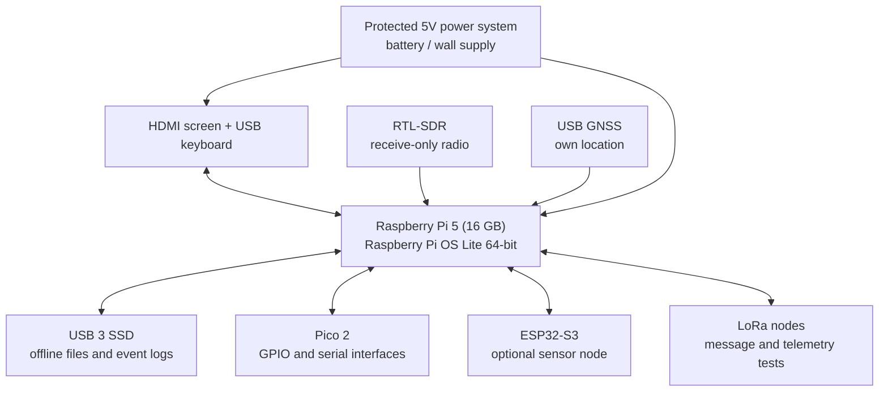
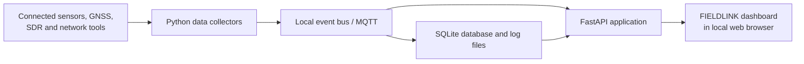

# FIELDLINK — Modular Raspberry Pi 5 Cyberdeck

> **Current status:** Planning and design. FIELDLINK is a proposed engineering prototype, not a completed product. The cover is concept art. The Raspberry Pi AI HAT+ 2 is **not included** in the current build; AI acceleration is a future upgrade.

## Project Owner

**Name:** Mohammad Abdul Rafay Chaudry  
**Virginia Tech Email:** rafaych@vt.edu

## Project Overview

**FIELDLINK** is a portable, modular computing and electronics workstation—also called a *cyberdeck*—that I will design, assemble, and program around a **Raspberry Pi 5 (16GB)**. I want to create a self-contained platform for learning embedded systems, Linux, cybersecurity, hardware debugging, radio reception, GPS navigation, and environmental monitoring. It will combine a display, keyboard, rechargeable power, local storage, and replaceable accessory modules in one protective case.

Unlike a conventional laptop, FIELDLINK will expose practical engineering connections and let me change its internal hardware. Its custom **Mission Control** dashboard will bring together my own sensor measurements, system status, network diagnostic results, permitted radio observations, GPS position, and historical logs. Once set up, many functions can run without internet access.

**Planned use cases** (each requires the named hardware and software to be implemented and tested):

| Capability | Example use | Required hardware |
| --- | --- | --- |
| Linux and software development | Write Python scripts, run local services, manage files | Raspberry Pi 5, storage, screen/keyboard |
| Authorized network diagnostics | Check connectivity, inspect packets on a lab network, troubleshoot SSH | Pi Ethernet/Wi-Fi |
| Hardware hacking and embedded development | Program a microcontroller, read UART logs, interface with sensors | Pico 2, protected adapters, wiring |
| Radio signal reception | Display a spectrum waterfall and decode supported public broadcasts | RTL-SDR, appropriate antenna |
| Off-grid communications | Exchange short messages and telemetry between two test nodes | Two compatible LoRa nodes |
| Offline mapping | Display downloaded maps and log the deck's own coordinates | USB GNSS receiver, stored maps |
| Environmental monitoring | Record temperature/humidity and opt-in occupancy sensor alerts | ESP32 and selected sensors |
| Mission Control dashboard | View sensor data, network status, logs, and maps in one interface | Software developed for Pi 5 |

**Minimum viable prototype (MVP):** Raspberry Pi boots reliably into a local Linux environment; a custom dashboard displays a real sensor reading received from a Pico 2; the reading is timestamped and saved locally; and I demonstrate one authorized network diagnostic. The complete prototype adds the display, battery, SDR, LoRa, GPS, and enclosure.

**Scope limits:** This is not military-certified equipment. I will not attempt covert surveillance, identify people from Wi-Fi disturbances, intercept private transmissions, or test networks without permission. Wi-Fi movement sensing is experimental, needs extra hardware and informed consent, and is not a dependable person-identification system.

## What I Hope to Learn

Through this project, I hope to gain practical experience with:

- **Embedded Linux:** installing Raspberry Pi OS, using the terminal, configuring services, managing permissions, remote access, backups, and recovery.
- **Computer hardware and system integration:** selecting compatible interfaces, understanding ARM architecture, measuring CPU/RAM/disk usage, and identifying performance bottlenecks.
- **Electronics:** 3.3V logic, GPIO, UART, I²C, SPI, wiring, protected inputs, grounding, basic schematic design, and microcontroller firmware.
- **Networking and security:** TCP/IP, SSH, Wireshark, safe packet capture, logging, and security hardening on authorized test systems.
- **RF and wireless communications:** software-defined radio, antennas, GNSS, LoRa message transfer, and factors that affect radio reception.
- **Programming and data systems:** Python, APIs, asynchronous sensor collection, SQLite, MQTT, a browser dashboard, and automated tests.
- **Mechanical design and power:** enclosure measurement and CAD, mounting, cooling, battery budgeting, current limits, and safe wiring.
- **Engineering practice:** estimating a budget, sourcing components, recording design decisions, conducting repeatable tests, and documenting progress through GitHub.

## Design and Implementation

### 1. Proposed block diagram



*This is a functional block diagram, **not** a wiring schematic. Power rails, USB capacity, fuses, and exact pin assignments must be verified before assembly.*

### 2. Planned software architecture



The initial OS will be **Raspberry Pi OS Lite (64-bit)**. I plan to implement the dashboard using Python/FastAPI and a lightweight web interface. Device collectors will run as system services. SQLite will store time-stamped events; MQTT may be introduced when there are multiple sensors or nodes. The dashboard will be accessible locally without depending on a cloud provider. Advanced AI processing is deferred to a separate future phase.

### 3. Main design decisions

| Choice | Why I chose it | Limitation / verification needed |
| --- | --- | --- |
| Raspberry Pi 5, 16GB | Small, standalone Linux computer with a documented GPIO ecosystem | ARM software compatibility and performance need testing |
| Raspberry Pi OS Lite 64-bit | Stable Pi hardware support and freedom to build my own interface | Must configure the user interface and services |
| External USB 3 SSD | Easy-to-replace local storage for maps, code, and logs | Check USB power draw and boot method |
| Pico 2 | Handles GPIO, timing-sensitive interactions, and electronics demonstrations | Requires firmware and proper voltage protection |
| Optional ESP32-S3 boards | Independent low-cost wireless and sensor experiments | Wi-Fi sensing is research only; not person identification |
| Receive-only RTL-SDR | Low-cost introduction to RF observation | Antenna-dependent; cannot transmit |
| Two LoRa nodes | Allows an actual two-device communications demonstration | Low data rate and variable range |
| Certified battery + regulator | Safer and easier to maintain than custom lithium cells | Verify exact 5.1V/5A Pi requirements and accessory power |
| Modular protective enclosure | Components remain removable and repairable | Modified case cannot be assumed waterproof |

### 4. Electrical and mechanical design

The Pi 5 and peripherals will have a documented power budget before a battery is selected. The Pi needs a suitable high-current **5.1V supply**; voltage levels, cable ratings, total load and protection must be measured. All GPIO-level connections will use suitable 3.3V logic and protected adapters; industrial or higher-voltage signals must never connect directly to GPIO.

I will design a removable internal mounting plate, preserve cooling airflow, use strain relief and insulated connectors, and provide accessible ports. Exact circuit schematics, wiring diagrams, an enclosure CAD model, and a connector/pin map will be added once the physical components are selected. The design must allow a damaged module to be replaced without taking apart the whole system.

### 5. Testing methods

| Test | Evidence to upload | Acceptance criterion |
| --- | --- | --- |
| Linux stability | Boot log, temperature readings, test notes | Two hours of representative operation without crash |
| GPIO + Pico | Code, wiring photo, video | Pi command controls an LED and reads a sensor |
| Mission Control | Screenshot, database sample | Real sensor events are timestamped, stored, and shown offline |
| Network tools | Redacted capture and command log | Diagnose an authorized test network without leaking private data |
| SDR | Screenshot and reception log | Observe one permitted signal with suitable antenna |
| LoRa | Transmit/receive logs from two nodes | Successful short test message in both directions |
| GNSS and mapping | Offline map screenshot and GPS log | Outdoor position appears on stored map |
| Battery and thermal | Voltage/current and runtime chart | Safe, stable operation and documented runtime; target 2+ hours |
| Physical assembly | Photos and repair notes | A module can be removed and reinstalled without damage |

## Bill of Materials

All amounts are **planning estimates in USD**, not confirmed store quotations. Links identify manufacturers, distributors, or useful product searches; exact models will be chosen before purchase. **No AI HAT is included in this budget.**

| Item | Quantity | Estimated Cost | Link |
| --- | ---: | ---: | --- |
| Raspberry Pi 5, 16GB | 1 | $305 | [Raspberry Pi](https://www.raspberrypi.com/products/raspberry-pi-5/) |
| Active cooler | 1 | $20 | [Raspberry Pi](https://www.raspberrypi.com/products/active-cooler/) |
| 1TB USB 3 SSD | 1 | $110 | [SSD options](https://www.amazon.com/s?k=1tb+external+usb+ssd) |
| 7–10-inch HDMI screen | 1 | $100 | [Waveshare displays](https://www.waveshare.com/) |
| Keyboard with touchpad | 1 | $40 | [Keyboard options](https://www.amazon.com/s?k=compact+usb+keyboard+touchpad) |
| Raspberry Pi Pico 2 | 1 | $5 | [Raspberry Pi](https://www.raspberrypi.com/products/raspberry-pi-pico-2/) |
| Breadboard, wires, basic sensors, serial adapter | 1 set | $35 | [DigiKey](https://www.digikey.com/) |
| ESP32-S3 development boards | 2 | $40 | [Espressif](https://www.espressif.com/en/products/socs/esp32-s3) |
| RTL-SDR receiver and antenna | 1 kit | $65 | [RTL-SDR](https://www.rtl-sdr.com/) |
| US-band LoRa development boards | 2 | $50 | [Heltec](https://heltec.org/project/wifi-lora-32-v3/) |
| USB GNSS receiver | 1 | $35 | [Adafruit GNSS](https://www.adafruit.com/category/86) |
| Powered USB 3 hub | 1 | $30 | [Hub options](https://www.amazon.com/s?k=powered+usb+3+hub) |
| Certified battery and regulated power accessories | 1 set | $150 | [Battery options](https://www.anker.com/) |
| Protective case and mounting plate | 1 set | $90 | [Case options](https://www.harborfreight.com/) |
| Cables, mounting screws, connectors, fusing, strain relief | 1 lot | $75 | [DigiKey](https://www.digikey.com/) |
| Optional camera and presence sensors | 1 set | $65 | [Adafruit sensors](https://www.adafruit.com/) |
| **Hardware subtotal** | | **$1,215** | |
| **Contingency (15%, rounded)** | | **$182** | |
| **Estimated Total Cost** | | **$1,397** | |

**Estimated Total Cost:** **$1,397**, including contingency, before tax, shipping, tools and paid labor. The $65 optional sensing allowance can be postponed. Existing lab monitors, keyboards, and power supplies will be used during early development where possible; a certified wall supply and boot media will be confirmed and budgeted before procurement.

**Funding approach:** Funding will be requested in stages rather than all at once. A preliminary $450 authorization would cover an initial Pi-based test bench with access to existing lab peripherals. Additional purchases will be approved only after the preceding milestone has been demonstrated and documented. The funding amounts and dates will be adjusted to actual quotations and the lab's approval process; unused funds carry forward rather than being spent automatically.

**Future upgrade (not funded):** Raspberry Pi AI HAT+ 2 for compatible on-device inference after the base computer, sensors, and dashboard meet their acceptance tests.

## Timeline and Milestones

**Proposed project window:** October 19, 2026 – January 10, 2027. The schedule will be adjusted after parts ordering and sponsor approval.

| Milestone | Target Date | Status |
| --- | --- | --- |
| Project planning and parts approval | 2026-10-23 | Not Started |
| Initial architecture, power and interface design | 2026-11-01 | Not Started |
| Core Raspberry Pi + Pico sensor prototype | 2026-11-08 | Not Started |
| Integrated dashboard, display and network tools | 2026-11-29 | Not Started |
| SDR, LoRa, GNSS and offline functionality | 2026-12-20 | Not Started |
| Portable power, enclosure and verification | 2027-01-03 | Not Started |
| Project documentation and final demonstration | 2027-01-10 | Not Started |

**Milestone 1 — Core prototype (Weeks 1–3):** Install Linux, confirm storage and power, program the Pico, and display timestamped sensor values in a local dashboard. **Funding gate:** show a working demonstration, commit code and photographs, and reconcile the first purchase receipts before requesting screen and expansion funding.

**Milestone 2 — User interface and diagnostics (Weeks 4–6):** Connect display and keyboard, run authorized network diagnostic tools, and save events locally. **Funding gate:** demonstrate the integrated interface and approved data collection before asking for radio modules.

**Milestone 3 — Field communications (Weeks 7–9):** Demonstrate SDR reception, GPS over offline maps, and a message exchanged between two LoRa nodes. **Funding gate:** provide actual screenshots/logs and an updated electrical plan before requesting final battery and case funds.

**Milestone 4 — Portable prototype (Weeks 10–12):** Finish mounting and power, conduct thermal and runtime tests, and document what works and what remains experimental.

## Progress Log

### 2026-10-19 — Project planning

**Worked on:** Defined the Raspberry Pi 5-based FIELDLINK scope, current feature set, proposed architecture, component budget, and milestones.  
**Completed:** Documentation draft and initial concept illustration only.  
**Problems / open questions:** Exact part availability, power budget, physical fit, accessory current draw, and hardware interface compatibility still need verification.  
**Next steps:** Obtain parts approval, select specific models, verify quotations and build the initial Linux/Pico test bench.  
**Evidence:** This README; `hero.png` is concept art rather than a completed-build photograph.

### YYYY-MM-DD — Next progress update

**Worked on:**  
**Completed:**  
**Problems / open questions:**  
**Measurements and evidence:**  
**Next steps:**

## Project Files

The following files/folders will be added **as they are created**. This is a planned structure, not a claim that schematics, code or tests already exist.

```text
FIELDLINK/
├── README.md                 # This project proposal
├── hero.png                  # Required cover image (concept art)
├── docs/
│   ├── diagrams/             # Hardware architecture and power diagrams
│   ├── design/               # Engineering decisions and CAD renders
│   └── test-results/         # Photos, logs, measurements
├── hardware/
│   ├── schematics/           # Circuit designs and pin mappings
│   └── enclosure/            # CAD files and mounting layout
└── software/
    ├── firmware/             # Pico / ESP32 programs
    ├── backend/              # Data collection and API services
    └── dashboard/            # Mission Control interface
```

As work progresses I will commit firmware, source code, pinouts, assembly photographs, component datasheets, and redacted test results. Keys, passwords, precise private location histories, and raw third-party communications will not be committed.

## Useful Links

- [Raspberry Pi 5 official documentation](https://www.raspberrypi.com/documentation/computers/raspberry-pi.html)
- [Raspberry Pi OS and Imager](https://www.raspberrypi.com/software/)
- [Raspberry Pi Pico 2](https://www.raspberrypi.com/products/raspberry-pi-pico-2/)
- [Raspberry Pi GPIO and hardware interfaces](https://www.raspberrypi.com/documentation/computers/raspberry-pi.html#gpio)
- [Python documentation](https://docs.python.org/3/)
- [FastAPI documentation](https://fastapi.tiangolo.com/)
- [Mosquitto MQTT](https://mosquitto.org/)
- [Wireshark documentation](https://www.wireshark.org/docs/)
- [GNU Radio](https://www.gnuradio.org/)
- [RTL-SDR project](https://www.rtl-sdr.com/)
- [Meshtastic documentation](https://meshtastic.org/docs/)
- [Espressif ESP32-S3 documentation](https://www.espressif.com/en/products/socs/esp32-s3)
- [OpenStreetMap](https://www.openstreetmap.org/)
- [Kiwix offline knowledge](https://kiwix.org/)

## Project Image

The project image is saved at **[`hero.png`](hero.png)** in the repository root. It is an **illustrative concept image**, not a photograph of assembled hardware. I will replace it with a real photo of the FIELDLINK prototype once the hardware is built, retaining the required filename `hero.png` so the AMP Lab website can display it.
